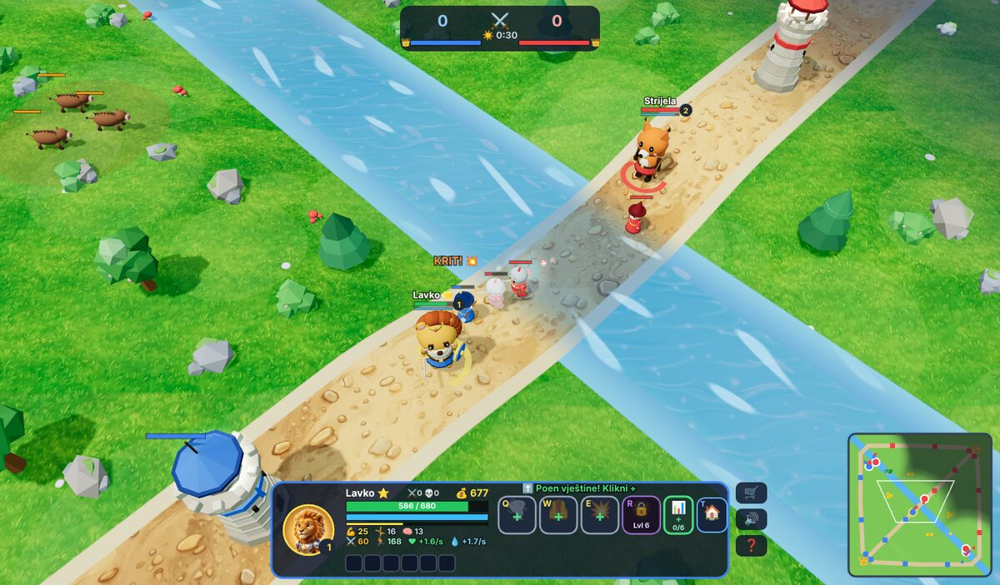
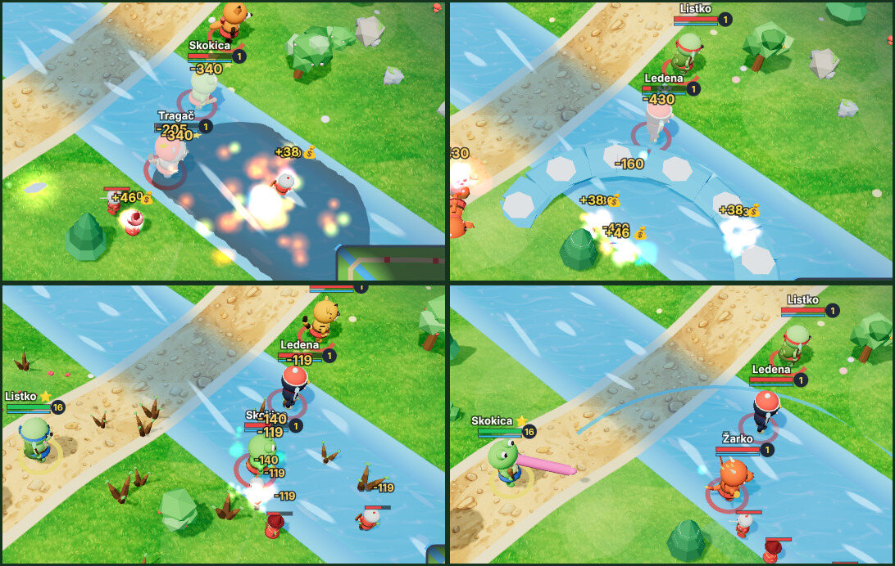
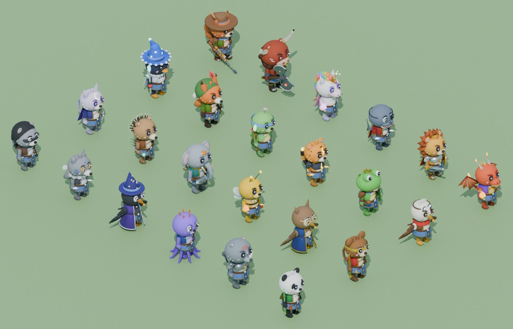

# 🏰 DOTA Kids 3D ⚔️

> 🇬🇧 **English:** a kids' DOTA-style MOBA in 3D that runs in the browser — 24 heroes, 5 vs 5 against bots or with a friend online, talking heroes, achievements, works on tablets. **The whole game is available in English** (and in Croatian/Bosnian and Serbian, Latin and Cyrillic) — pick the language on the start screen (or open the game with `?lang=en`). Play: [dota-kids-brown.vercel.app](https://dota-kids-brown.vercel.app/?lang=en)

Dječji DOTA All-Stars klon u 3D — kompletan mini-MOBA koji radi u pregledniku, bez instalacije. **v0.43: 🌍 cijela igra i na srpskom (latinica i ćirilica) i engleskom — biraš na početku — i 🎬 novi početni ekran.** v0.42: 🏆 postignuća i profil — 15 postignuća, pobjede sa svakim junakom i 🎖️ „Novo postignuće!” na kraju igre.** v0.41: 🔊 novi zvuk — bogatiji efekti, prostorni zvuk (lijevo/desno, tiše izdaleka) i 🌲 zvukovi prirode.** v0.40: 🪙 pomoć za zadnji udarac, 💡 savjeti za početnike, 🏅 medalje na kraju igre, 🗺️ portreti na minimapi i 🔥 junaci „u vatri”.** v0.39: čišći ekran (brojevi štete samo kad si ti uključen, manje poruka), 💨 brže putovanje izvan borbe i 🪙 zlatnici koji polete do tebe kad pobijediš junaka.** v0.38: veliko poliranje — ⛶ cijeli zaslon, 🐿️ Nišan i 🐂 Bikoš, 🎓 svaki junak ima svoje talente, 💥 kritični udarci, 🛒 jasniji dućan, 🗺️ veća mapa, 🗼 aggro kao u Doti, 🌫️ prava magla rata, 🌿 tango jede drvo i 🤖 pametniji botovi (gankovi, guranje, obrana).** (v0.37: 👥 pravih 5 na 5, v0.36: peglanje za mobitel i opisi gumba, v0.35: u mrežnoj igri svatko vidi svoje, v0.34: 📣 najavljivač, 🤖 težina botova, 💀 pregled pogibije, 💃 ples)



**🎮 Igraj odmah: [dota-kids-brown.vercel.app](https://dota-kids-brown.vercel.app)**

Ili lokalno: preuzmi repo i otvori `index.html` dvoklikom (radi offline — Three.js je uključen; za multiplayer treba internet).

## 🌐 Multiplayer (ti protiv prijatelja, 5 na 5)

1. Igrač 1 klikne **📡 Napravi sobu** i dobije kod od 4 znaka
2. Igrač 2 upiše kod i klikne **🔌 Uđi**
3. Oba odaberu junake i stisnu **✅ SPREMAN!**
4. Domaćin je 🔵 plavi mid, gost 🔴 crveni mid — svaki sa 4 bota saveznika, pravi 5v5!

P2P preko WebRTC-a (PeerJS), bez servera. Magla rata vrijedi za svakoga iz perspektive njegovog tima, a ako igrač izleti — bot preuzima njegovog junaka.

## Što je u igri

- 🌍 **Četiri jezika i novi početni ekran** (v0.43):
  - 🇭🇷🇧🇦 **hrvatski / bosanski**, 🇷🇸 **srpski latinica**, 🇷🇸 **српски ћирилица** i 🇬🇧 **engleski** — cijela igra: junaci, moći, predmeti, dućan, savjeti, poruke, pomoć i postavke
  - srpski nastaje iz hrvatskog teksta: rječnik ijekavica → ekavica (pobjeda → pobeda, strijela → strela) i srpske riječi (dućan → prodavnica, tko → ko, postavke → podešavanja); ćirilica se dobiva iz latinice (tipke Q W E R i kratice HP, OK ostaju latinicom)
  - pri prvom pokretanju igra pita **„🌍 Jezik · Језик · Language”**; kasnije se jezik mijenja gumbom gore desno na početnom ekranu ili u ⚙️ postavkama (🌍 Jezik); izbor se pamti
  - link s `?lang=hr`, `?lang=sr`, `?lang=cy` (ćirilica) ili `?lang=en` odmah otvara igru na tom jeziku
  - 🎬 **novi početni ekran**: veliki logo, ▶️ ZAIGRAJ, gumbi 👥 S prijateljem / ❓ Kako se igra / 🏆 Postignuća / ⚙️ Postavke, traka sa svim junacima (klik na junaka = odmah ga odabereš), kratki profil (pobjede, igre, postignuća) i kartice što sve igra ima; radi i na mobitelu
  - 🏠 gumb gore lijevo na ekranu odabira vraća na početni ekran; „Igraj ponovo” ide ravno na odabir junaka

- 🏆 **Postignuća i profil** (v0.42) — igra pamti (u pregledniku) tvoje igre i pobjede:
  - 🎖️ **15 postignuća**: 🎉 Prva pobjeda, 🩸 Prva krv, ⚔️ Lovac (10 pobjeda nad junacima u igri), 🪙 Zlatar (100 zadnjih udaraca), 🔥 U vatri (5 zaredom bez pada), 🛡️ Neuništiv (pobjeda bez ijednog pada), 🤝 Timski igrač (15 asistencija), 🏰 Rušitelj (zadnji udarac na 3 kule), 🐲 Zmajoubojica, 🌿 Proždrljivac (4 drveta tangom), 👑 Najbolji, 🎓 Legenda (level 25), 🦸 Junak (pobjeda na „Teško”), 🌈 Svestran (pobjede s 5 junaka) i 🏆 Prvak (10 pobjeda)
  - na kraju igre nova postignuća iskoče odmah ispod „POBJEDA!” (uz zvono), a ispod tablice piše tvoj profil (pobjede, igre, postignuća)
  - 🏆 gumb **Postignuća** na ekranu odabira: sva postignuća (otključana i 🔒 zaključana s opisom što treba napraviti), broj igara i pobjeda i junaci s kojima najčešće pobjeđuješ
  - 🏆 na kartici junaka piše koliko si puta pobijedio s njim

- 🔊 **Novi zvuk** (v0.41):
  - 🎚️ svi zvučni efekti idu kroz zajednički „mikser” (kompresor + malo jeke): kad je puno toga odjednom, zvuk više ne pucketa i ne preglasi se, a bojište zvuči kao prostor
  - 🎧 **prostorni zvuk**: udarci, strijele, moći i rušenja u svijetu čuju se tiše što su dalje od sredine ekrana i s lijeve ili desne strane — po zvuku znaš gdje se nešto događa
  - 💥 bogatiji efekti umjesto „bip” tonova: tup udarac mača, fijuk strijele, svjetlucanje magije, gromki ulti, prasak eksplozije, rušenje kule, kritični rez, zvona za level i zlato, fijuk skoka
  - 🪙 **zvuk zlatnika** kad dobiješ zlato za vojnika i kad zlatnici polete do tebe nakon pobjede nad junakom
  - 🤫 tuče vojnika su puno tiše od udaraca junaka (prije je stalno lupalo)
  - 🌲 **zvukovi prirode** (⚙️ postavka, uključeno): blagi vjetar, danju ptice, noću cvrčci, a kad je kamera kraj rijeke — žubor vode

- 🏅 **Za početnike i za zabavu** (v0.40):
  - 🪙 **pomoć za zadnji udarac**: iznad neprijateljskog vojnika kojeg tvoj SLJEDEĆI udarac pobjeđuje pojavi se zlatnik (i zlatni okvir trake života) — udari ga baš tada i dobiješ zlato; tvoj vojnik kojeg možeš uskratiti dobije ❗. Djeca tako lako nauče farmati (isključuje se u ⚙️ postavkama)
  - 💡 **savjeti za početnike** — kratka poruka iznad ploče junaka u pravom trenutku: malo života („teleport kući”), imaš zlata za sljedeći predmet, pojedi drvo tangom, otključaj ulti na levelu 6, kula gađa tebe, kupuj dok čekaš oživljavanje, teleport do kule… Svaki savjet najviše 2 puta (pamti se), jedan po jedan; isključuju se u ⚙️ postavkama, a ponovno uključivanje vrati sve savjete
  - ⬆️ **vještine se mogu učiti same** (⚙️ postavka, isključena): poen koji ne potrošiš za 2–3 s potroši se sam — prvo ulti, pa ravnomjerno
  - 🏅 **medalje na kraju igre**: 🥇 Lovac (najviše pobjeda), 🤝 Pomagač (asistencije), 🪙 Zlatar (zadnji udarci), 💥 Razbijač (šteta junacima), 🏰 Rušitelj (šteta kulama), 🛡️ Neuništiv (najmanje padova) — prikazuju se uz imena, a ispod tablice piše koje si ti osvojio
  - 🗺️ **minimapa s portretima**: junaci su okrugli portreti u boji tima (ti u zlatnom prstenu), iznad magle — odmah vidiš tko je gdje
  - 🔥 **junak „u vatri”**: tko pobijedi 3+ junaka zaredom, dobije plamičke nad glavom i 🔥 uz ime — zaustavi ga i dobiješ puno zlata
  - 🟢🟡🔴 **težina junaka** na ekranu odabira (zelena točkica = lako za početnike: Lavko, Žarko, Strijela, Listko, Tutnjo, Rogo, Bambus, Duga, Bikoš)
  - ❤️ crveni rub kad imaš malo života više ne pulsira u bazi (tamo si siguran)

- 🧹 **Čišće i zabavnije** (v0.39):
  - 🔢 **brojevi štete samo kad si TI uključen** — tvoji udarci, tvoji prizvani pomoćnici i udarci u tebe (crveni); u tučnjavi 5 na 5 ekran više nije zatrpan brojevima, a brzi udarci (otrov, glad, plamen) spoje se u jedan broj. Isto vrijedi za „Promašaj!” i kritične brojeve (crveni rez preko mete i dalje vide svi)
  - 🤫 **manje poruka**: botovi se rjeđe hvale i zovu pomoć, timske poruke (gank, obrana, guranje) najviše jednom u 12–30 s, „Stigli su veliki vojnici!” samo prvi put, a ista poruka se ne ponavlja odmah (u probnoj partiji prije je bilo 173 poruke u 15 minuta)
  - 💨 **brže putovanje**: kad 6 s nisi u borbi (ne udaraš junake ni građevine i oni ne udaraju tebe), junak je 15 % brži, a kad izađeš iz fontane, 10 s puše „vjetar doma” (+40 %) — dok ne uđeš u borbu; vidi se po vjetru za petama i znački 💨 među bonusima. Na većoj mapi puno manje dosadnog hodanja
  - 🪙 **pobjeda nad junakom**: zlatnici iskoče iz pobijeđenog i polete do pobjednika; kad pobijediš TI, ekran zlatno bljesne, kamera se trgne i malo približi, a igra na tren uspori (samo protiv botova)
  - 🛡️🔭🍖 traka bonusa pokazuje i Bojni zov, Durbin i Ratnu glad

- ✨ **Veliko poliranje** (v0.38):
  - ⛶ **cijeli zaslon** — gumb ⛶ gore desno (i na ekranu odabira), a igra se sama otvori preko cijelog ekrana kad klikneš ▶️ ZAIGRAJ. U cijelom zaslonu **miš ne može pobjeći iz igre** (ni na drugi monitor): igra „zaključa” miš i crta svoj pokazivač (⚔️ mač nad neprijateljem, 🎯 nišan pri ciljanju), pa pomicanje kamere uz rub uvijek radi. Kad otvoriš dućan, postavke ili pomoć, miš se sam otpusti; klik na igru ga opet zaključa, **Esc** ga pusti. Oboje se može isključiti u ⚙️ postavkama (🖥️ Cijeli zaslon, 🔒 Miš ostaje u igri)
  - 🐿️ **Nišan — novi junak kao Sniper u Doti**: vjeverica snajperist s dugom puškom i durbinom, gađa s 430 (najdalje u igri). Pasiva 🎯 *Pogodak u glavu* (dodatna šteta, kratka omama, odbačaj) • Q 🌰 *Kiša žirova* (dugo pada na daleko mjesto, usporava) • W 💣 *Šišarka-bomba* (odbaci neprijatelje — i tebe ako si blizu, za bijeg!) • E 🔭 *Durbin* (6 s gađaš puno dalje i brže) • R 🔫 *Savršen hitac* (nišani protivničkog junaka do 2000 daleko: crveni laser i nišan nad metom, pa hitac koji uvijek pogodi)
  - 🐂 **Bikoš — novi junak kao Axe u Doti**: crveni bik s golemom dvostrukom sjekirom. Pasiva 🌀 *Bikovski vrtlog* (kad ga udare, ponekad se zavrti i rani sve oko sebe) • Q 🗯️ *Bojni zov* (neprijatelji oko njega moraju napadati samo njega, a on dobiva jaki oklop) • W 🍖 *Ratna glad* (meta gubi život dok nekoga ne pobijedi) • E 🐂 *Bikovski skok* • R 🪓 *Smrtni udarac* (ranjenog junaka odmah pobijedi — tim potrči brže, a ulti je opet spreman)
  - 🎙️ oba nova junaka imaju **svoj glas i 9 replika** (na engleskom, kao ostali), 3D model iz Blendera s animacijama (Nišan nišani i trza se od pucnja) i portret
  - 🎓 **svaki junak ima SVOJE talente** (24 × 4 razine × 2 izbora): umjesto istih bonusa za sve, talenti jačaju baš njegove moći — npr. Žarkova Vatrena kugla probija sve, Strijelino Sokolovo oko gađa dva junaka, Pipkov Zagrljaj pipaka dulje drži, Skakačeva Majmunska vojska ima 4 majmuna. Stablo talenata vidiš na ekranu odabira (🎓 pločica), a odabrani talent se vidi i u opisu moći
  - 💥 **kritični udarci**: veliki narančasti broj koji iskoči i zatrese se, crveni rez u obliku X preko mete, bljesak oružja prije zamaha, jači crveni trag zamaha, crveni projektil kod daljinskih junaka i poseban zvuk
  - 🪄 **animacije magija i napada**: vještine vuku svijetlu vrpcu (trag), ulti skupi energiju u junaka uz bljesak ekrana, skokovi ostavljaju trag iskrica, crveni rub ekrana kad te jako udare i kad ti je malo života, efekti za sve nove moći (kiša žirova, šišarka-bomba, laser nišana, zamah sjekirom, vrtlog)
  - 🛒 **jasniji dućan**: lijevo kategorije s razumljivim imenima (⭐ Za tebe, 💰 Mogu kupiti, 🧪 Napitci, 💪 Atributi, 🗡️ Oprema… ⚔️ Oružje, 👑 Legendarno) sa zelenom značkom koliko toga možeš kupiti; predmeti su **kartice s imenom, onim što daju i cijenom** (crveno „fali 150” kad nemaš dovoljno); gore veliki gumb **„⭐ Kupi sljedeće”**; dolje recept („složi od: A + B + 📜 = predmet”), veliki gumb „🛒 Kupi za X” ili „🔒 Fali još X” i tvoja torba s porukom stiže li predmet odmah ili ga nosi 🫏 kurir
  - 🗺️ **veća mapa za 5 na 5** — testirano simulacijom: mapa je 28 % veća u svakom smjeru (1,45 → 1,85), protivnici su prosječno ~1550 umjesto ~1240 daleko, ima više mjesta za džunglu (4 nova kampa: vukovi i 🪨 kameni golemi koji omamljuju) i više drveća; igra traje prosječno ~18–23 minute
  - 🗼 **aggro kao u Doti 2**: napadneš li junaka blizu protivničke kule ili vojnika, kula i njegovi vojnici navale na TEBE (vojnici te ganjaju ~2 s); klikneš li svog vojnika, protivnički vojnici te puste. Vojnici bez druge mete napadaju junake do 500 udaljenosti
  - 🗡️ **kule su opasne na početku**: prvih 10 minuta junacima rade **dvostruku štetu** (do 20. minute polako pada na ×1,3), a svaki sljedeći pogodak u istog junaka jači je za 25 % (do ×2) — nema više ronjenja pod kulu na levelu 3
  - 🌫️ **prava magla rata**: vid ide u zrakama — **drveće zaklanja pogled**, a s nizine se ne vidi na viši plato (kao u Doti); kule i fontana vide u krugu, oči 👁️ i noć rade kao prije; neprijatelje u magli ne možeš ciljati, a zaključani cilj se izgubi kad nestane u magli. Magla se crta glatko, i na tlu, zgradama, drveću i vodi
  - 🌿 **tango jede drvo**: klikni tango pa **klikni drvo** (zeleni krug pokaže najbliže) — junak dođe do njega, pojede ga i 16 s liječi; drvo nestane i izraste za 3 minute (vidi i gost u mrežnoj igri). 🪓 Sjekirica sada siječe drveće (otvori prolaz!)
  - 🤖 **pametniji botovi — timska taktika**: svaki tim ima „zapovjednika” koji botovima daje naredbe: **🗡️ gank** (2 bota odu na usamljenog ili ranjenog protivnika na drugoj stazi), **🛡️ obrana** (kad ruše našu kulu, najbliži dođu — i teleportom), **🏰 guranje** (kad je tim jači, zajedno guraju stazu), **🔄 promjena staze** i **🐲 Veliki Zmaj** kad protivnici leže. Botovi javljaju u timske poruke što rade („🗡️ Sivko i Zubo idu u gank na Lavka!”, „🛡️ Rogo brani kulu!”), a odgovaraju na tvoje pingove i „⚔️ Napadamo!”
  - 🌀 **teleport na kulu**: T pa klik na svoju kulu ili vojarnu (i na minimapi) — 3,5 s i stižeš; T dvaput = kući. Na odredištu raste stup svjetla koji vide i protivnici
  - 🎨 **ljepši 3D modeli**: svi modeli dobili su bolje „oslikano” sjenčanje (plohe prema nebu toplije i svjetlije, odozdo hladnija sjena) pa iz kamere odozgo izgledaju obliji; novi modeli metka, puške i sjekire
  - 🧪 `tools/sim/sim.js` — simulacija cijelih partija bez preglednika (`node tools/sim/sim.js 4 --max=2700`) za provjeru ravnoteže, veličine mape i ponašanja botova

- 👥 **5 na 5** (v0.37) — timovi su sada veliki kao u DotA-i i LoL-u:
  - 🤖 sam igraš: **ti + 4 bota 🔵 protiv 5 botova 🔴**; s prijateljem: domaćin i gost vode sredinu, a svaki ima **po 4 bota**
  - 🛣️ raspored po stazama kao u DotA-i: **sredina sama** (tu si ti), na gornjoj i donjoj stazi **po dvoje**
  - ⚖️ igra je provjerena simulacijom (botovi vode oba tima): partija traje prosječno **18,5 minuta** (3 na 3: 14,7), a pomoć timu koji zaostaje kreće tek kad zaostaje 2500 zlata (prije 1500) jer veći timovi skupe više zlata
  - 🏆 završni ekran i 📋 tablica pokazuju svih **10 junaka** — i na mobitelu (zaglavlje stupaca samo jednom, manji redovi; na najmanjim ekranima se pomiče, a gumb „Igraj ponovo!” je uvijek vidljiv)
  - ⚡ i dalje brzo: logika igre +12 %, crtanje +5 % poziva, mrežna snimka za gosta najviše ~10 KB
  - ⚔️ početna najava u mrežnoj igri: „5 NA 5!”

- 🧽 **Peglanje 2** (v0.36):
  - 📱 **mobitel položen** (nizak ekran): ⚙️ postavke se mogu pomicati pa je gumb „Nastavi” uvijek dostupan; 📋 tablica stisne redove da stanu svih 6 junaka i crta se preko minimape; 🏆 završni ekran je zbijeniji i pokazuje oba tima; 🛒 dućan koristi cijelu visinu umjesto da se prelije preko ploče junaka; 💀 pregled pogibije stane između minimape i moći; ubojstva/smrti na ploči junaka više se ne preklapaju sa zlatom
  - 💬 **opisi gumba gore desno** (💃 ples, 🎯 kamera, 📋 tablica, ⚙️ postavke, 🔊 zvuk, ❓ pomoć) — prijeđi mišem i vidiš što rade i koja je tipka
  - 🌐 gost u mrežnoj igri: njegove vlastite poruke („🔒 Treba ti poen vještine!”, „Nema mane!”…) više ne nestanu za tren (snimka domaćina ih je brisala)
  - 📰 poruke koje vidi samo drugi tim više ne guraju tvoje poruke s popisa
  - 🤖 u izborniku „S prijateljem” težina botova je zasivljena (u mrežnoj igri botovi su uvijek normalni)
  - ✅ cijela igra od 12 minuta s glasovima i crtanjem (bot vodi tvog junaka, „Teško”) prošla je bez ijedne greške

- 🌐 **Mrežna igra: svatko vidi svoje** (v0.35) — popravci za igru 1 na 1 preko interneta:
  - 🎉 **osobne najave** idu samo onome kome pripadaju: tko ubije junaka vidi „Bravo!”, a tko padne „Ne brini!” (prije je gost vidio domaćinove najave, npr. „Bravo! Pobijedio si Rogo!” kad je upravo on poginuo); i gost sada dobiva „🌟 ULTI dostupan!” i „🎓 Talent!”, a otkup mu makne „Ne brini!”
  - 🏆 na kraju igre svatko zadrži **svoju** najavu („POBJEDA!” ili „PORAZ…”) — prije bi je kod gosta za tren prepisala domaćinova
  - 💰 **osobne poruke iznad junaka** (zlato za ubojstvo, asistenciju, kulu, „Nema mane!”, „Teleport prekinut!”…) vidi samo njihov vlasnik — i gost sada vidi svoje zlato, a domaćin više ne vidi tuđe
  - 🔵🔴 poruka o buffu iz džungle stiže samo timu koji ga ima
  - 🔊 gost čuje zvuk kad pobijedi junaka i kad dobije level (kao domaćin)

- 📣 **Najavljivač, težina botova, pregled pogibije i ples** (v0.34):
  - 📣 **najavljivač kao u DotA-i** — dubok, gromki glas (na engleskom) najavljuje važne trenutke: „Welcome to Dota Kids!”, „Let the battle begin!”, **„First blood!”**, višestruka ubojstva (**„Double kill!”, „Triple kill!”, „Ultra kill!”, „Rampage!”**), nizove (**„Killing spree!”, „Dominating!”, „Mega kill!”, „Unstoppable!”, „Incredible!”, „Monster kill!”, „Godlike!”, „Beyond godlike!”**), „Shut down!”, „Ace!”, srušene kule i vojarne, ranjiv prijestol, Velikog Zmaja i zmajčiće, noć i dan, te **„Victory!” / „Defeat…”**
  - 👂 svatko čuje iz **perspektive svog tima**: „Enemy tower destroyed!” kad padne protivnička kula, a „Our tower has fallen!” kad padne naša — radi i za gosta u mrežnoj igri
  - 🔇 junaci i najavljivač **ne pričaju u isto vrijeme**: puno važnija replika prekida trenutnu, a ostale pričekaju na red (npr. prvo „First blood!”, pa tvoj junak „Justice wins!”); najavljivača isključiš u ⚙️ postavkama (📣 Najavljivač)
  - 🤖 **težina botova** na ekranu odabira: **🐣 Lako** (protivnički botovi sporije reagiraju, rjeđe bacaju moći i koriste predmete, oprezniji su, ne otkupljuju se i zarađuju 25% manje zlata), **⚔️ Normalno** (kao prije) i **🔥 Teško** (brži, hrabriji, 25% više zlata); saveznici su uvijek normalni, igra pamti izbor, a završni ekran pokazuje težinu. U simulacijama (4 igre po težini, i tvog junaka vodi bot) tvoj tim na „Lako” pobijedi svaku igru, a protivnici skupe tek ~6,6 tisuća neto vrijednosti (na „Normalno” ~15 tisuća i 2 od 4 pobjede)
  - 💀 **pregled pogibije kao u LoL-u**: kad pogineš, vidiš tko te ubio i tko ti je u zadnjih 15 sekundi nanio koliko štete — s portretom junaka, trakom i čime (npr. „🔥 Vatrena kugla 230 · ⚔️ Napadi 190”), uključujući kule, vojnike i čudovišta; i gost u mrežnoj igri dobiva svoj pregled
  - 💃 **ples na tipku J** (ili gumb 💃 gore desno): junak zapleše pobjednički ples, iznad glave mu zasviraju 🎶 i kaže **šaljivu repliku** — svih 22 ima svoju („Ha! Even my mane can dance!”, „Bzzz! Honey dance time!”, „Arr! Eight arms, eight times the dancing!”…); prestaje čim kreneš, napadneš ili baciš moć, a vide (i čuju) ga i drugi, i u mrežnoj igri
  - 🦁 Lavko ima novi, plemeniti glas (njegov stari epski glas sada je najavljivač)

- 🗣️ **Glasovi junaka** (v0.32, na engleskom od v0.33) — kao u LoL-u i DotA, svaki junak ima **svoj glas i 8 replika na engleskom** (176 replika, napravljeno s [Fish Audio](https://fish.audio)):
  - 🇬🇧 **engleski kao u pravim igrama** — djeca usput uče engleski, a imena junaka ostaju naša (Lavko, Žarko, Zuja, Zubo…) i izgovaraju se kako treba
  - 🎙️ **22 različita glasa** po karakteru: hrabri Lavko, vatreni Žarko, hladna Ledena, lukava Strijela, spori djed Listko, munjeviti Munja, razigrana Skokica, ponosna Orlina, tajanstvena Luna, šaptač Tragač, gunđalo Bodljo, duboki Tutnjo, zujava Zuja, mudra Mudra, vragolan Skakač, režeći Sivko, dramatični Mrak, gusar Pipko, glasni Rogo, mirni Bambus, čarobna Duga i gladni Zubo
  - 👆 **odabir** — klikneš junaka na početnom ekranu i on se predstavi („Lavko the brave, ready for battle!”)
  - 🌟 **ulti** — svaki junak vikne svoj ulti („Dragon's breath! Feel the heat!”, „Stampede! The ground shakes!”), a **ulti protivnika i suigrača u blizini** isto čuješ
  - 🏆 **pobjeda nad junakom**, 💀 **pogibija** („Meow... I still have eight lives left.”) i ⏳ **povratak u igru**
  - 🚶 **ponekad dok hodaš ili napadaš** — kratka replika, ali ne na svaki klik (hodanje najviše svakih 12 s, napad svakih 7 s); držanje miša ne priča
  - 🔇 govori **samo jedan glas u isto vrijeme** — važnija replika (ulti, pobjeda, pogibija) prekida manje važnu, a manje važna ne prekida važniju; prati 🔊 glasnoću i 🎵 zvuk, a u ⚙️ postavkama ih možeš **isključiti** (🗣️ Glasovi junaka)
  - 📱 radi i na iPadu/iPhoneu (zvuk se „otključa” prvim dodirom) i u mrežnoj igri (gost čuje svog junaka)
  - ⚡ učitana replika krene istog trena, pa se ne preskoči ni kad igra na tren zastane (npr. prvi ulti na slabijem tabletu) (v0.33)
  - 📝 replike i odabrani glasovi su u [`voices.js`](voices.js); igra učitava samo replike tvog junaka i ulti ostalih junaka u meču

- 🎯 **Ciljanje mišem, indikatori i priprema** (v0.31) — popravci po prijavama testera:
  - ⏳ **30 sekundi pripreme na početku** (kao u DotA prije roga): sat kreće od **-0:30**, dućan se sam otvori da kupiš predmete, a vojnici, čudovišta u džungli, rune i pasivno zlato kreću tek u **0:00** uz zvuk roga; zadnjih 5 sekundi otkucava; u igri protiv botova gumb **▶️ Kreni odmah** preskače čekanje
  - 🖱️ **klik na junaka pogađa bilo gdje na tijelu** (glava, trbuh, noge): jedinica pod mišem bira se po svom tijelu na ekranu, a ne po točki na tlu iza nje — prije je klik na glavu protivnika promašio i junak je samo otišao iza njega
  - ⭕ **jedinica pod mišem zasvijetli**: crveni krug pod neprijateljem (zeleni pod prijateljem, žuti pod čudovištem), okvir oko njegove trake života, a pokazivač postaje ⚔️ mač; pri ciljanju moći pokazivač je 🎯 nišan
  - 🏹 **strijela projektila pokazuje PRAVI domet i širinu** — vatrena kugla leti 760 i strijela je toliko duga (prije je išla samo do miša, pa je izgledala kratko); skokovi i juriši pokazuju točno mjesto slijetanja i širinu udarca
  - ⛰️ **indikatori leže na terenu**: krug djelovanja, prsten dometa i strijela prate brežuljke, nasipe i rijeku (prije su bili ravni diskovi koji su se skrivali pod tlom); isto i **zone moći** (gdje pada meteor, kiša strijela, korijenje…), pa se vidi kamo ne smiješ stati
  - 🎯 **moć ide točno na junaka pod mišem**: klikneš li junaka dok ciljaš (ili pustiš tipku kod brzog bacanja), krug ili strijela se prilijepe za njega
  - 🐞 **nišan više ne zaostaje**: točka na tlu ispod miša računa se u svakoj sličici, pa indikator prati miš i dok kamera prati junaka (prije je moć znala odletjeti na staro mjesto); **držanje tipke Q** više ne baca moć samo od sebe (preglednik ponavlja pritisak tipke)
  - ⚔️ **A pa klik — napad u hodu**: junak ide onamo i usput napada neprijatelje (junake, vojnike, čudovišta, građevine); crveni krug pokazuje domet napada
  - 🖱️ **drži tipku miša** na tlu i junak stalno ide za mišem; **desni klik dok ciljaš** odustaje i odmah daje običnu naredbu
  - ⚡ **brzo bacanje** (Postavke): drži tipku moći = vidiš domet i krug, pusti = baci prema mišu (za iskusnije igrače; uobičajeno je pritisni pa klikni)
  - ✅ Ucjena (Tragač) sada traži metu samo unutar prstena dometa koji pokazuje (prije je hvatala junaka bilo gdje uz miš), a Zamjena (Mrak) pokazuje pravi krug hvatanja

- 🦸 **Potpisni detalji svakog junaka** (v0.30) — kao kod LoL junaka, svatko ima svoj prepoznatljiv rekvizit koji priča njegovu priču i moći (smješten tako da se vidi i odozgo, iz kamere u igri):
  - 🦁 **Lavko**: kraljevski plašt sa zlatnim rubom i velikim zlatnim lavljim suncem s rubinom na leđima
  - 🔥 **Žarko**: rogovi koji gore na vrhovima, žar duž repa, zlatna narukvica s vatrenim draguljem
  - ❄️ **Ledena**: ledeni naramenjaci od svjetlećih kristala i ledeni kristali oko kićanke kape
  - 🏹 **Strijela**: smotana lovačka mreža na boku (njena moć) i ogrlica od očnjaka
  - 🍄 **Listko**: crvene gljive s bijelim točkama, lišće i ružičasti cvijet na oklopu, vitica s listićima oko štapa
  - ⚡ **Munja**: velika svjetleća munja-cik-cak na čelu (vidi se i odozgo), svjetleći vrh repa s iskrama i munje na nadlakticama
  - 👑 **Skokica**: mala zlatna kruna s rubinom (žablji princ)
  - 🧣 **Orlina**: pilotski šal u boji tima čiji dugi krajevi vijore iza leđa
  - 🌙 **Luna**: svjetleći polumjeseci na vrhovima luka i srebrne naušnice; polumjesec na čelu sada prati zaobljeno čelo (prije je stršao u zraku i odostraga se vidio kao "S" iznad glave)
  - 💣 **Tragač**: dvije dimne bombe sa svjetlećim fitiljem (njena moć) i bacački noževi za remenom
  - 🧪 **Bodljo**: bočica zelene sluzi na boku i narukvice s bodljama
  - 🐘 **Tutnjo**: zlatni ukras na čelu s rubinom, zlatni prstenovi na kljovama, crvene rese na ušima
  - 🍯 **Zuja**: svjetleći vrhovi ticala i lončić meda s kapljicom
  - 👓 **Mudra**: okrugle zlatne naočale i broš s polumjesecom
  - 🍌 **Skakač**: banana za pojasom i crvene vrpce na vrhu zlatnog štapa
  - 🐺 **Sivko**: plave ratničke pruge na licu, ogrlica od zuba i srebrni pun mjesec
  - ⭐ **Mrak**: zvijezde i polumjesec na čarobnjačkom šeširu, ovratnik od perja, ljubičasti broš
  - 🪸 **Pipko**: kruna od koralja i biserna ogrlica
  - 🦏 **Rogo**: čelični obruč na rogu, šiljci na naramenjacima, crvene ratničke pruge
  - 🎋 **Bambus**: slamnati šešir na leđima i tikvica s crvenom vrpcom
  - 🌈 **Duga**: narukvice u bojama duge i svjetlucave zvjezdice oko roga
  - 🏴‍☠️ **Zubo**: gusarski povez preko oka, zlatni zub i veliko zlatno sidro na pregači
  - 🖼️ novi portreti 12 junaka iz Blendera s novim detaljima
  - ⚙️ bez troška u igri: +2 poziva crtanja i +0,4 % trokuta u ispitnoj sceni (7 junaka + 12 vojnika), modeli 5,1 MB (+0,1 MB)

- ⚔️ **3D modeli bliže League of Legendsu** (v0.29):
  - 🎨 **"ručno oslikani" izgled svih modela** (kao teksture u LoL-u): uz pečenu okluziju svaki model dobiva prijelaz od tamnijeg podnožja prema svjetlijem vrhu, hladnije i zasićenije sjene, toplije svjetlo i blagi šum poteza kistom — sve u bojama vrhova, bez troška u igri
  - ✨ **pravi metal**: zlato i čelik na junacima i zgradama (oklopi, naramenjaci, mačevi, štitovi, krune, zlatni lukovi kula) imaju vlastiti materijal sa sjajem i odsjajem okoline; noću odsijavaju slabije
  - 🧥 **sekundarni detalji kao kod LoL junaka**: pregača (tabard) sprijeda i straga u tamnijoj boji tima sa zlatnim rubom i znakom, zlatne zakovice uz rub tunike, šavovi i dragulj u boji tima na pojasu, kožni remen preko prsa s okruglom zlatnom kopčom (pješaci, strijelci, borci s kandžama), zlatne ogrlice s draguljem za čarobnjake
  - 🛡️ **oklopi i oružje**: slojeviti naramenjaci sa zakovicama, zlatni amblem-sunce na oklopu, čelične kapice i zlatni rubovi čizama, širi mač sa svjetlećom runom i većim križem, zakovice i zlatna zvijezda na štitu, dragulj na luku, čelične narukvice uz kandže, željezni obruč na batini, još jedna kost u krilima
  - 🦁 **Lavkova griva** od šiljatih pramenova u dva prstena oko cijelog lica (prije mjehurići samo s jedne strane); čuperci krzna/perja na tjemenu Strijele, Munje, Majmuna, Vuka, Pande, Lune i Orline
  - 💎 likovi imaju blagi sjaj (oslikani odsjaj), a kameni golem ostaje bez zlatnih ukrasa
  - 🖼️ **novi portreti** 12 junaka iz Blendera na ekranu odabira (s novim detaljima)

- 🌳 **Džungla, svjetlo i vojnici** (v0.28):
  - 🌲 **živa džungla**: drveće, grmlje i kamenje su mat (bez plastičnog odsjaja koji je krošnje činio bijelima), zelene boje su bogatije, krošnje malo veće, a uz stabla raste grmlje — šume izgledaju gušće; ispod stabala je tamnije šumsko tlo pa se šume odvajaju od svijetlih livada
  - 🪨 manje kamenja i sivo umjesto bijelog (prije je džungla izgledala kao da je posuta konfetima); na Scourge strani svjetliji tamni borovi i mrtvo drveće s jarkim crvenim i ljubičastim lišćem
  - ☀️ **mekše svjetlo**: slabije plavkasto nebo i umjerenija ekspozicija — vrhovi krošnji, kamen i junaci se više ne "isperu" u bijelo, boje su dublje
  - ☠️ **Scourge vojnici** imaju svoj izgled (kao Dire u DotA): kostur-vitezovi s rogatim kacigama, nazubljenim mačem i štitom s lubanjom, tamni čarobnjaci s kapuljačom i lubanjom na štapu, koštana opsadna kola s lubanjom na ovnu
  - 🔥 **pravi Vatreni vuk** (crveni buff): tamnocrveno krzno, plamena griva i leđa, svjetleće oči; svetište tamnijeg kamena
  - 🏰 **zgrade bez "ispranog" bijelog**: kule, prijestoli, vojarne, fontane i svetišta imaju vlastiti materijal sa slabijim odsjajem, pa se vidi pravi topli kamen; **zidine oko baza su kamene** (samo vrhovi stupova u boji tima, prije su bile cijele plave kao plastika), šatori isto; svetište u mirovanju ima mali sjaj samo oko kugle; Scourge fontana opet ljubičasta

- 🎨 **Dizajn i 3D modeli** (v0.27):
  - 🐉 **četiri prava zmajčića** iz Blendera umjesto prebojanog Velikog Zmaja: 🔥 vatreni (plamen na leđima, žar na obrazima), 💧 vodeni (leđna peraja, peraje na glavi, mjehurići), ⚡ olujni (krijesta od munja, svjetleći rogovi), 🌿 šumski (lišće, cvjetići i mahovina); oko svakog lete čestice njegovog elementa
  - 🏰 **nove kule**: topli tamniji kamen (više se ne "ispere" u bijelo), stepenasto postolje s potpornjima, zastave tima sprijeda, zupci na konzolama i **veliki lebdeći kristal** u zlatnoj kruni umjesto krova (kod Scourgea u koštanim kandžama, s ljubičastim runama); kule su malo veće
  - 🌳 **Sentinelov prijestol "Drvo života"**: kameni podij sa zlatnim rubom i stubama, stupovi sa zlatnim kapitelima, deblo s korijenjem i tri grane koje drže kristal, krošnje sa svjetlećim plodovima
  - 🛡️ **štit prijestola** dok čuvarske kule stoje: svijetli samo rub kupole (prije je bijela izmaglica skrivala prijestol)
  - 🏛️ **popločani trg** oko prijestola i fontane (svijetli kamen i zlatni ukrasi za Sentinel, tamne ploče i ljubičaste rune za Scourge) umjesto ravnih prozirnih krugova; rub trga se gubi u travi
  - 🗺️ **rub mape bez šava**: tlo izvan mape uzima boju terena i polako prelazi u šumu i stijene (prije oštra crta i taman pojas)
  - ⛲ fontane opet pokazuju vodu (prsten u boji tima više ne prekriva bazen), podij prijestola bez ružičastog/plavog diska, mekše podloge kampova
  - 🦁 junaci su malo veći (lakše ih je vidjeti na tabletu)

- 🐉 **Zmajčići, tablet i postavke** (v0.26):
  - 🐉 **zmajčići na rijeci** (dolje desno, umjesto Mede Brunde): 🔥 *Vatreni* (+6% štete), 💧 *Vodeni* (+3 obnove života i +1,5 mane), ⚡ *Olujni* (+5% brzine), 🌿 *Šumski* (+3 oklopa) — tim koji ubije zmajčića dobiva **trajni bonus za sve junake** i bonusi se zbrajaju; novi zmajčić (drugog elementa) dolazi nakon 2,5 min. Vide se na minimapi u boji elementa, u traci buffova (×2, ×3…) i u tablici; botovi ih love u paru od 5. minute
  - 👆 **igranje na tabletu**: dodir = hodaj / napadni / gumb, povlačenje prstom = kamera, dva prsta = zum; gumbi 📋 tablica i 🎯 kamera na junaka; držiš prst na predmetu = opis, a 1 s = prodaja (uz potvrdu)
  - ⚙️ **postavke** (gumb gore desno ili **Esc**): glasnoća, zvuk, kvaliteta slike (niska / srednja / visoka — niska je brža na slabijim tabletima), efekti, kamera uz rub ekrana, brojevi štete; igra pamti izbor, a protiv botova stoji dok su postavke otvorene
  - 🖱️ **kamera uz rub ekrana** kao u DotA i LoL-u: miš uz sam rub pomiče kameru
  - 🐞 popravci: klik na ploču HUD-a više ne šalje junaka tamo ispod nje; gost u multiplayeru sada vidi Vatrenog vuka (a ne vepra)

- ⚡ **Detalji iz League of Legends** (v0.25):
  - ✨ **čarolije prizivača** na tipkama **D** i **F**: ⚡ *Bljesak*, 💚 *Iscjeljenje*, 🔥 *Zapaljenje* (gori i slabije se liječi), 👻 *Duh*, 🫧 *Barijera* (štit), 🐌 *Iscrpljenost*, 🌩️ *Kazna* (za džunglu i zmaja) — biraš ih na ekranu junaka (igra pamti izbor), okrugli gumbi u petom stupcu naredbene kartice; botovi ih biraju po ulozi i koriste
  - 🔵🔴 **buffovi džungle**: *Plavi golem* daje plavi buff (mana i 15% kraće hlađenje), *Vatreni vuk* crveni buff (udarci pale i usporavaju) — 90 s, a pogineš li, buff preuzima tvoj ubojica; čudovišta s buffom svijetle i vide se na minimapi
  - 📊 **traka buffova** iznad ploče junaka: sve što ti pomaže (zeleno) ili šteti (crveno) s preostalim sekundama i opisom
  - 🏚️ **vojarne se obnavljaju** 4 minute nakon rušenja (kao inhibitori) — super vojnici tada nestaju, pa tim koji gubi može se vratiti
  - 💀 **ACE!** kad padne cijeli protivnički tim
  - ❤️ **trake života kao u LoL-u**: crtice svakih 100 života, svjetliji trag izgubljenog života, bijeli štit, kućica s levelom; 🎯 **strelica ciljanja** za magije koje lete ravno i svijetli rub kruga djelovanja
  - ⌨️ glif je sada na tipki **Y** (F je čarolija prizivača)
  - 🤖 **botovi procjenjuju borbu**: napadaju kad im strana nije slabija (level, predmeti, život, saveznici u blizini), inače se povuku k svojoj kuli — manje "hranjenja" i ujednačenije igre (u simulacijama 9–23 min)

- 🧽 **Peglanje** (v0.24):
  - 🏆 **završni ekran kao u DotA**: oba tima s portretima, K / D / A, zadnjim udarcima, **neto vrijednošću** i slikama predmeta (uz neutralni), 👑 najbolji igrač; **tablica na Tab** u istom stilu
  - 🤝 **asistencije**: suigrači koji su udarili metu ili su bili blizu (1000) dobivaju asistenciju i +50 zlata
  - 🏰 **utvrđene građevine (kao u Allstarsu)**: junaci rade 50% štete građevinama, opsadni vojnici 125%; kule imaju oklop, a dublje kule više života i oklopa (1. kula 2600, 2. kula 3250, čuvari 3575), prijestol 5000 života — igre opet traju dulje, a ne završe za 8 minuta
  - 🔄 **zlato za povratak u igru**: kad tim koji zaostaje ubije junaka tima koji vodi, ubojica dobiva dodatno zlato (do +400) — manje jednostranih igara
  - 🧪 **pametniji botovi**: kupe tango na početku i ljekoviti melem kad su ranjeni, umjesto da stalno pješače do fontane
  - 💬 **jedinstveni opisi**: moći, urođena pasiva, atributi, glif, teleport i dućan imaju isti opis kao predmeti (s brojkama za trenutni i sljedeći rang)
  - 🐞 popravci: ikone predmeta se stvaraju trenutno (dućan kod gosta u multiplayeru se više ne zamrzava), opis predmeta i dućan se zatvaraju na kraju igre, nova igra počinje bez stare brze kupnje

- 🛒 **Predmeti kao u DotA** (v0.23):
  - 🗡️ **74 predmeta**: *Osnovni* (potrošno, atributi, oprema, razno, rijetko) i *Nadogradnje* (pribor, podrška, čarolije, oklop, oružje, artefakti) — Grančica, Narukvica snage, Fazne čizme, Čizme moći, Čarobni štapić, Ljekoviti medaljon, Štap sile, Vjetrovita palica, Dagon, Kraljevski oklop, Napadački oklop, Srce titana, Bojna sjekira, Dedalova oštrica, Oštrica pustoši, Lubanjolomac, Ponorna oštrica, Leptir, Sjenovita oštrica, Vampirski mač, Sunčev kamen…
  - ⚙️ **prave DotA statistike**: atributi (snaga / okretnost / inteligencija), brzina napada, **oklop** (smanjuje štetu udaraca; kule i vojarne imaju svoj), krađa života, izbjegavanje, kritični udarci, tresak (omama), zamah po skupini, blok štete, skidanje oklopa, aure za saveznike i ~25 aktivnih predmeta (vihor, ledeni val, zlatni dodir, treptaj, osvježenje moći…); botovi kupuju po vodiču i koriste aktivne predmete
  - 🖼️ **prikaz kao u DotA**: pravokutne slike predmeta u boji kvalitete (sivo, zeleno, plavo, ljubičasto, narančasto), dućan sa stupcima po kategorijama, tražilicom, **⭐ vodičem** za tvog junaka, receptom ("Sastojci" / "Ulazi u") i **desnim klikom za kupnju**; opis predmeta kao u DotA (statistike, PASIVNO / AKTIVNO s manom i hlađenjem, priča)
  - 🎒 **torba 3×2 + ruksak 3**: povuci predmet mišem na drugo mjesto, u ruksaku ne djeluje; hlađenje se prikazuje kao sat koji se otvara, punjenja dolje desno, tipke 1–6 gore lijevo; 📌 **brza kupnja** iznad naredbene kartice pokazuje što još fali za prikvačeni predmet

- ⚔️ **Animacije udaraca i magija** (v0.22):
  - 🎯 **trenutak udarca kao u DotA**: junak, vojnik i čudovište prvo zamahnu, a šteta (ili strijela / vatrena kugla) dolazi točno u kadru kad oružje pogodi; brži napad = brži zamah; omama prekida zamah, a magija ga prekida bez gubitka udarca (kule pucaju odmah)
  - 🗡️ **jači zamasi**: Blender animacije napada imaju napinjanje, iskorak i zamah koji prođe kroz udarac; strijelci se trznu kad puste tetivu, čarobnjaci "gurnu" kuglu; **kritični udarac, kombo i udarac iz sjene** imaju poseban, jači zamah i svjetliji trag oružja
  - 🏹 **daljinski napadi** polijeću iz ruke ispred junaka (ne iz trbuha), a u ruci se skupi svjetlo dok junak napinje
  - 💥 **pogodak**: meta se trzne unatrag od napadača, iskra sjevne na strani s koje je došao udarac
  - ✋ **magije**: ruke "bace" čaroliju baš kad se efekt pojavi, uz bljesak svjetla u rukama i iskre u smjeru bacanja; skokovi imaju odraz i doskok s udarnim valom
  - 🆕 **novi efekti na mjestu cilja**: 💨 *Dimna bomba* (gust sivi dim), 🐙 *Zagrljaj pipaka* (ljubičasti pipci iz tla), 👁️ *Sovino oko* (stup svjetla i runski krug), 💰 *Ucjena* (zlatni stup i zlatnici nad metom) — vide se i kod gosta u multiplayeru

- 🗺️ **3D dorada, 3. dio** (v0.21):
  - 🖥️ **HUD kao u Warcraftu 3**: minimapa dolje lijevo, u sredini ploča junaka (portret, život/mana/iskustvo, atributi) s **torbom 2×3** odmah uz portret i okruglim mjestom za neutralni predmet, a dolje desno **kartica naredbi** — moći Q W E R u prvom redu, ispod atributi, 🌀 teleport, 🛡️ glif i 🛒 dućan; zvuk i pomoć su gore desno
  - ☁️ **sjene oblaka** polako klize preko cijele mape (danju jače, noću se gotovo ne vide), a nad **rijekom lebdi izmaglica** — mekani pramenovi koji plove niz vodu (noću gušći)
  - 🚩 **živahne zgrade**: zastave na kulama i vojarnama vijore se na vjetru (Scourge kule imaju poderani barjak na koštanom koplju s lubanjom), iz dimnjaka Sentinel vojarni izlazi siv dim, iz Scourge kripti ljubičasti pramenovi, a **kristal kule pulsira** i brže se vrti dok kula puca

- ⛰️ **3D dorada, 2. dio** (v0.20):
  - ⛰️ **litice oko baza**: plato svake baze završava strmom liticom od slojevitog kamena (Sentinel: siva stijena s travom na vrhu, Scourge: tamni kamen s pepelom i ljubičastim kristalima), a gdje staze ulaze u bazu teren se spušta blagom **rampom** — kao u Allstarsu; visine terena računaju se jednom u mrežu (brže)
  - 🪨 **kameni rubnici** duž sve tri staze
  - 💥 **udarci**: zvjezdasta iskra na svakom pogotku (veća za jake udarce); kad padne kula ili vojarna, razlete se kamene krhotine koje odskakuju po tlu, digne se oblak prašine, kristal se rasprsne i bljesne svjetlo
  - 🏛️ **HUD u stilu Allstarsa**: tamne ploče s dvostrukim rubom i zakovicama (Sentinel: tamno drvo i zlato, Scourge: tamni kamen, kost i ljubičasto), gumbi moći oštrijih kutova s unutarnjim rubom, minimapa prikazuje pravi teren

- 🏔️ **3D dorada, 1. dio** (v0.19):
  - 🗺️ **mapa je 45% veća** (4350×4350): baze, staze, kule, kampovi, rune i svetišta raspoređeni po istom planu, ali je svijet veći u odnosu na junake (kao u DotA); džungla je gušća (oko 270 stabala)
  - ☠️ **Sentinel i Scourge**: crveni tim ima vlastite Blender zgrade — šiljati tamni tornjevi s koštanim rebrima i kandžama oko kristala, prijestol okružen golemim koštanim šiljcima i lubanjama, fontana s ljubičastom tekućinom, kripte umjesto kućica i zidine sa šiljcima; na njegovoj strani mape zemlja potamni i izgubi boju, šuma je mrtva (uvijena stabla s tamnocrvenim lišćem, pepeljasti borovi), umjesto cvijeća leže kosti, a zrakom lebde ljubičaste iskrice
  - 🏞️ **rub svijeta**: izvan mape teren se diže u šumovita brda i stjenovite planine sa snijegom na vrhovima, s velikim stijenama i šumom koja stoji na brdima
  - ✨ **post-processing**: HDR render s MSAA, sjaj (bloom) na magijama, kristalima, bakljama i prozorima, malo jače boje i kontrast, vinjeta i hladniji ton noću; tipka **K** pali/gasi, a na sporim uređajima se samo isključi
  - ⚡ ukrasi se crtaju po komadima mape — samo ono što kamera vidi (manje trokuta na većoj mapi)

- 🧭 **Jasniji izbor junaka** (v0.18): kratak naslov i jedna rečenica o igri; kartice samo sa slikom, imenom i ikonom ⚔️/🏹; filtri *Svi / Blizina / Daljina*; desno 3D model, uloga i 5 pločica (✨ urođena pasiva + Q W E R) — prijeđi ili klikni pločicu za opis; prvi junak je odmah odabran pa je dovoljno pritisnuti **ZAIGRAJ**; multiplayer se otvara gumbom 👥; na mobitelu su gumbi uvijek pri dnu ekrana

- ⚔️ **Patch sposobnosti** (v0.17):
  - ✨ **Urođene pasive odvojene od moći**: svaki junak ima jednu pasivu (okrugla značka gore desno na portretu, opis kad prijeđeš mišem) koja uvijek radi i sama jača na levelima 7 / 13 / 19 — više ne troši poene ni mjesto među moćima. Nove pasive: 🔥 *Vatrena krv* (Žarko — napadi pale), 🌱 *Korijeni* (Listko — liječi se kad stoji), 💧 *Vodozemac* (Skokica — brža i liječi se u rijeci), 🔭 *Orlovski vid* (Orlina — veći domet), 🌙 *Mjesečeva oštrica* (Luna — napad odskoči na drugog neprijatelja)
  - 🆕 **Svaki junak ima 4 aktivne moći** — 17 novih: 📯 *Bojni poklič* (Lavko), 🛷 *Trbušno klizanje* (Ledena), 🕸️ *Lovačka mreža* (Strijela), 💨 *Dimna bomba* (Tragač), 🐾 *Tigrove kandže* (Munja), 🌰 *Klupko* (Bodljo), 💦 *Tuš iz surle* (Tutnjo), 🌬️ *Zuj-bijeg* (Zuja), 🌫️ *Tihi let* (Mudra), 🍌 *Banana* (Skakač), 💢 *Divlje kandže* (Sivko), 🪶 *Pernata oluja* (Mrak), 🫂 *Zagrljaj pipaka* (Pipko), 📢 *Izazov* (Rogo — neprijatelji moraju napadati njega), 🥴 *Pijani korak* (Bambus — izbjegava udarce), 🌉 *Dugin most* (Duga), 🌀 *Krvavi vrtlog* (Zubo); svaka ima svoj 3D efekt, a banana i mreža nove Blender modele
  - ⬆️ **Najviši level je 25**: Q/W/E imaju 4 ranga (rang 2/3/4 od levela 3/5/7), ulti 3 (leveli 6/12/18), višak poena ide u atribute (do 10 puta); 🎓 talenti na levelima 10, 15, 20 i 25
  - 🤖 botovi znaju nove moći (i bježe kad su ranjeni: Zuja, Mudra, Duga)

- ✨ **Glatki modeli** (v0.16): svi Blender modeli (junaci, vojnici, čudovišta, kule, drveće, kamenje, ukrasi, efekti) dobili su glatko sjenčanje, zaobljene rubove kocki, više segmenata na velikim oblinama i meke izbočine na krošnjama i kamenju; AO sjene se peku po vrhu pa su prijelazi mekani. Geometrija se sažima Dracom pa je `models.glb` ~4× manji nego prije (brže učitavanje, posebno na mobitelu)

- 🦄 **Novi junaci i DotA sitnice** (v0.15):
  - 🦄 **Duga** (jednorog, čarobnica podrške): 🌈 *Dugin snop* prolazi kroz sve neprijatelje i usporava ih, 💖 *Ljekoviti rog* liječi nju i prijatelje oko nje, ✨ *Čarobna griva* (pasivno) brže puni manu prijateljima u blizini, 🌠 ULTI *Zvjezdani galop* omami neprijatelje oko nje uz kišu zvijezda, a cijeli tim ubrza i dobije štit
  - 🦈 **Zubo** (morski pas, lovac): 🦷 *Ugriz* (rana krvari), 🌊 *Skok iz vode* (skok s valom gdje padne), 🩸 *Miris krvi* (pasivno: jače udara ranjene), 😤 ULTI *Pomama* (puno brži napadi, brže trčanje, svaki ugriz liječi)
  - 🧸 novi Blender modeli: jednorog sa spiralnim zlatnim rogom, grivom i repom u bojama duge; morski pas s leđnom i bočnim perajama, repom-polumjesecom, škrgama i osmijehom punim zubića; 3D projektil duge; portreti iz Blendera
  - 🌰 **Neutralni predmeti**: čudovišta u džungli ponekad ispuste predmet (3 razine — od 10. i 20. minute bolji), koji ide u novo okruglo mjesto pokraj torbe; najviše 3 po razini za svaki tim. U 3D-u iz čudovišta iskoči zelena škrinjica sa žirom i odleti do junaka
  - 💰 **Rune zlata** na 4 mjesta u džungli (od početka, svake 3 min) — zlato cijelom timu; 📘 **Rune mudrosti** u kutovima džungle (svakih 7 min) — puno iskustva. Novi 3D modeli (vrećica zlatnika, čarobna knjiga), prikaz na minimapi; botovi ih skupljaju kad su blizu
  - 💬 **Brze poruke** (G pa 1–6) i 📍 **ping** (V) — suigrači vide stup svjetla s pribadačom i krugove na minimapi; botovi zovu pomoć kad su ranjeni i malo se pohvale nakon ubojstva; radi i u multiplayeru

- 🫏 **Kurir i 3D magije** (v0.14):
  - 🫏 **Kurir**: predmet kupljen daleko od baze (dalje od 900 od fontane) čeka u škrinji — u torbi je blijed s magarčićem i još ne radi. **Leteći magarac** tvog tima poleti s fontane, donese ga junaku i vrati se kući. Vratiš li se sam u bazu, predmete uzmeš odmah. Recepti rade i s dijelovima koji čekaju kurira. Na minimapi je 🫏, protivnički kurir se vidi samo kad nije u magli
  - 🧸 **novi Blender model kurira**: sivi magarčić s pernatim krilima (puna ploha + tri reda pera s plavkastim vrhovima), sedlom u boji tima sa zlatnim rubom, drvenim sandukom s okovima i draguljem tima, zastavicom, pilotskim naočalama, dugim ušima koje mrdaju i čupavim repom; animacije mirovanja (lagano mahanje) i leta (snažni zamasi, podvučene noge); sanduk zasja dok nosi predmete, iza krila ostaje trag iskri
  - 🌪️ **Vrtlog** (Lavko): oko junaka se digne zlatni prozirni **tornado** od spiralnih traka vjetra s lišćem i kamenčićima
  - 🔥 **Plameni krug** (Žarko): iz tla izbije **prsten plamenih jezika** koji treperi i ostavi nagoreno tlo
  - 🌩️ **Gnjev oluje** (Munja): nad Munjom se skupi **olujni oblak** i iz njega u nizu udaraju izlomljene **munje** s ograncima — ravno u pogođene protivnike
  - Zuja i Pipko više nemaju krzno na obrazima

- ✨ **Detalji i magije** (v0.13):
  - 🧸 **detaljniji modeli** svih junaka: oči sa šarenicom, zjenicom, dva odsjaja, tuš-linijom i trepavicama; krzno na obrazima i prsima; prsti, palac i jastučić na šakama; potplati i prstići na stopalima; tunika sa zlatnim rubom, naborima, torbicom na pojasu i ovratnikom
  - ⚔️ **detaljnije oružje**: mač s draguljem u križnici i omotanom drškom, štapovi sa zlatnim prstenovima, luk s kožnim omotačem, čekić sa svjetlećim runama, kugla s čarobnim prstenom, batina s čavlima
  - 🛡️ **vojnici**: metalni umbo i zakovice na štitu, naramenice, vizir i veća perjanica; čarobnjaci sa zlatnim kandžama oko kugle, rubovima rukava i zvjezdicama na šeširu
  - 🌗 **rubno svjetlo** (fresnel) na svim modelima — obrisi se ističu, noću jače (mjesečina); AO se peče s više uzoraka
  - 🔮 **magije**: pod junakom se pri svakom bacanju zavrti **runski krug** u boji moći (kod ultija tri kruga i stup svjetla), AoE oko junaka šalje **udarni val**, a **točkasta svjetla** stvarno osvijetle teren pri bacanju, udaru projektila, otkucaju zone i padu meteora
  - ⚡ **munje i zrake** su sada debele svijetleće cijevi (izlomljene kod munja) s bijelom jezgrom umjesto tankih linija
  - 🎬 nova animacija **cast2**: magije s ciljem junak "baci" ispruženom rukom prema cilju; magije oko sebe i ulti — obje ruke uvis

- ⚔️ **DotA borba** (v0.12):
  - ❗ **Uskraćivanje (deny)**: klikom napadaš vlastitog vojnika ispod 50% života (ili kulu ispod 10%) — protivnik ne dobiva zlato i dobiva samo pola iskustva; botovi to rade i sami. U tablici (Tab) su sada **LH/DN** (last-hitovi i uskraćivanja)
  - 🛡️ **Zaštita od backdoora**: kula, vojarna i prijestol bez neprijateljskih vojnika u blizini primaju pola štete i sami se liječe — guranje ide s vojnicima, kao u DotA
  - 📣 **Najavljivač**: dvostruko / trostruko / ULTRA ubojstvo / POKOLJ i nizovi (dominira, mega, nezaustavljiv, čudovište, božanski…); 🛑 **prekinut niz** donosi dodatno zlato
  - 🌿 **Tango** (3 lista, polako vraća život), 💧 **Bistrina** (mana, prekida je udarac junaka), 🧀 **Zmajev sir** od drugog ubojstva Zmaja (+1500 života, +800 mane)
  - ✨ **3D**: svijetli **trag zamaha** pri svakom udarcu blizinskog junaka (drugi smjer kod drugog zamaha), **zlatnici** (Blender model) iskaču iz vojnika na last-hit, plavi štit iskri na kuli pod backdoor zaštitom

- 🌳 **Živa okolina i više složenosti** (v0.11):
  - 🌲 **novi Blender modeli okoline**: breze, panjevi, cvjetne krpice i busenje trave po cijeloj mapi, trska na obali i lopoči na rijeci, **kameni gazovi** gdje staze prelaze rijeku, **baklje** uz staze kod baza (noću svijetle), **šatori** u boji tima, bačve, sanduci i ograde u bazama, logorske vatre i svjetleći kristali uz kampove, veliko kamenje oko Zmajeve jazbine, putokazi — sve instancirano (jedan draw call po vrsti)
  - 🎓 **Talenti**: na levelima 10, 15, 20 i 25 biraš jedan od dva bonusa (+30 štete / +300 života, +15% brzine / −20% hlađenja, +60 štete / +650 života, +35% brzine napada / −15% hlađenja) — botovi biraju sami
  - 🕊️ **Svetišta** (DotA 7): po jedno u džungli svakog tima — ranjen junak stane uz njega i ono 5 s liječi cijeli tim u krugu, puni se 4 min
  - 🗿 **Kameni Golem**: novi neutralni kamp (po jedan na svakoj strani), svaki treći udarac omamljuje
  - 💪 **vojnici jačaju** svakih 7.5 min (+12% života i štete), kao u DotA
  - 🎯 auto-napad besposlenog junaka i dućan s kategorijama i preporukama (v0.10.1)

- 🐺 **Još junaka i DotA detalja** (v0.10):
  - 🐺 **5 novih junaka** (ukupno 20): **Sivko** 🐺 vuk (zavijanje koje jača tim, ugriz s krvarenjem, čopor, **Vučji oblik** — model naraste i zažari se), **Mrak** 🐦‍⬛ gavran (kletva — ukleti primaju više štete, **zamjena mjesta** s neprijateljem, krađa mane, jato gavranova koje ušutkava), **Pipko** 🐙 hobotnica (tinta — pogođeni promašuje, **pipci koji vuku** neprijatelje, sluzava koža, vrtlog dubina), **Rogo** 🦏 nosorog (**juriš** ravno kroz mapu dok ne zakači prvog, udarac rogom s odbačajem, debeli oklop, bijes), **Bambus** 🐼 panda (grom-pljesak, vrtoglavica, bambus, tri male pande)
  - 🛡️ **Glif utvrde** (tipka F): sve kule i vojarne tima 5 s neranjive, puni se 5 min — botovski tim ga sam koristi kad mu kula pada
  - 🍼 **Boca** (3 gutljaja, puni se kod fontane), 🌫️ **Prašina** (otkriva nevidljive, potroši se), 👁️ **Oko** (postavi oko u maglu rata), ☀️ **Sunčev kamen** (aura koja žari sve oko tebe — Radiance)
  - 🌀 nove mehanike: kletva (više primljene štete), 😵 sljepoća (promašaji), 🏃 juriš, 💥 odbačaj i povlačenje (modeli odlete lukom), 🔁 zamjena mjesta, 😡 bijes (omama svakim udarcem), krađa mane
  - 🎬 **drugi zamah napada**: svaki treći udarac je drukčija animacija (mač, kandže, krila, čarolija); novi modeli vuka, gavrana (čarobnjački šešir), hobotnice (8 pipaka), nosoroga (rog i oklop), pande (bambus) te mlaza tinte i gavrana koji kruže nad zonom

- 🏚️ **DotA mehanike** (v0.9):
  - 🦔 **5 novih junaka** (ukupno 15): **Bodljo** 🦔 jež-tenk (kiša bodlji koja se slaže, ljepljiva sluz, bodlje natrag napadaču, juriš), **Tutnjo** 🐘 slon (topot koji omamljuje, surla-zamah, debela koža, timski stampedo), **Zuja** 🐝 pčela (otrovni ubod, roj, med koji liječi tim, golema košnica), **Mudra** 🦉 sova (huk koji ušutkava, Sovino oko kroz maglu rata, noćna ptica, **Vječna noć** usred dana), **Skakač** 🐵 majmun (rastezljivi štap, skok, kombo svaki 3. udarac, **Majmunska vojska** — 3 poziva koji se bore uz tebe)
  - 🤢 **otrov**, 🤐 **ušutkavanje** (ne možeš bacati moći) i 👑 **imunost na čarolije** kao novi statusi; 🤝 **asistencije** se broje (udarac u zadnjih 10 s prije ubojstva)
  - 🏚️ **Vojarne** iza 2. kule na svakoj stazi — neranjive dok kula stoji; kad padnu, protivnički vojnici na toj stazi postaju **💪 SUPER vojnici** (veći, jači, s aurom); baze su ograđene **zidinama**
  - 💸 **Otkup** (tipka O ili gumb na ekranu smrti): plati zlatom i vrati se odmah — botovi ga koriste kad je prijestol u opasnosti; 🛡️ **Aegis** — tko ubije Zmaja dobiva jedno besplatno oživljavanje na licu mjesta (5 min)
  - 🪽 **Aktivni predmeti**: Skokne čizme (skok 600) i Kraljevski oklop (imunost 5 s) — tipke **1–6** ili lijevi klik na torbu; prodaja sada desnim klikom
  - 📋 **Tablica rezultata** (drži Tab): ubojstva / smrti / asistencije / level / zlato i predmeti svih 10 junaka; 👁️ Sovino oko se vidi na minimapi
  - 🎲 **Nasumičan junak** i traka učitavanja modela na ekranu odabira
  - 🎬 **Nove animacije**: **skok** (Skakač, Skokne čizme, Tragač, Skokica — stvarni luk kroz zrak), **kanaliziranje** (teleport kući), **pobjednički ples** svih junaka pobjedničkog tima na kraju i **drugi idle** (protezanje) kad junak dugo stoji
  - 🧸 novi Blender modeli: 5 junaka (bodlje, surla i kljove, krila i žalac, pernati disk i čuperci, traka na glavi i štap), vojarna s krovom u boji tima, zidine s barjakom, pčela, sluz i bodlja kao projektili; roj pčela kruži instancirano
  - 🌙 noć se sada **mekano prelijeva** (i kad je Mudra prizove), ljeti lete krijesnice po noći i latice po danu

- 🦁 **Ljepši modeli** (v0.8): svi junaci imaju lica s osmijehom, obrvama i velikim očima; svaki ima svoj potpis — Lavko ramene štitnike i veću grivu, Žarko veća krila, plamen na repu i trbušne ploče, Ledena pahuljicu na kapi i rukavice, Strijela pero u kosi, Listko cvijet na glavi, Munja munju na čelu i očnjake, Skokica pjege, Orlina naočale za nišanjenje i repna pera, Luna zvjezdani plašt, Tragač šuriken na remenu; vuk ima očnjake i krzneni ovratnik, medo kandže, Zmaj veća krila
  - 🌗 **Ambijentalna okluzija ispečena u Blenderu** (Cycles → boje vrhova): udubine, spojevi i krošnje su tamniji, pa svi modeli dobivaju dubinu bez ikakvog troška u igri; uz to i mekano studijsko osvjetljenje u three.js-u
  - 🎬 nove animacije: **trzaj** kad primiš udarac i **pogibija** (dvonošci padnu na leđa, četveronošci na bok) umjesto starog prevrtanja
  - 🏰 kule imaju istaknute cigle i prozore koji svijetle (noću izgledaju upaljeno)

- 🔥 **Čarolije u 3D-u** (v0.7): strijele, vatrene kugle, ledene strijele, pera, šurikeni, žirevi, mjesečeve strijele i sokoli su Blender modeli koji lete, vrte se i ostavljaju trag; žablji jezik se stvarno rasteže do mete
  - ☄️ **Meteor** pada s neba i ostavlja krater, 🌱 **korijenje** i 🧊 **ledeni kristali** izbijaju iz tla, 🏹 **kiša strijela** stvarno pada, 🌊 **val** se širi s pjenom, ⭐ zvijezde padaju, 💚 srca lebde pri liječenju
  - ⭐ zvjezdice kruže oko omamljenih, usporeni poplave, ukorijenjene drži korijenje, ubrzani ostavljaju trag
  - 👻 kad junak pogine, duh odleti, a ostane nadgrobni kamen do oživljavanja; ⬆️ stup svjetla pri levelu i oživljavanju
  - 📳 kamera se trese kod ultija, rušenja kula i udara meteora; 👑 kad prijestol padne, kristal se rasprsne u krhotine i kamera doleti na filmski završetak
  - 🌲 rub šume oko cijele mape, prašina pod nogama, iskre pri svakom pogotku, kule bljesnu kad pucaju

  

- 🧸 **3D modeli iz Blendera** (v0.6): svih 10 junaka-životinja, vojnici (pješak, čarobnjak, opsadna kola s ovnom), čudovišta iz džungle (veprić, vuk, medo, Veliki Zmaj s krilima), kule, prijestoli, fontane, drveće, kamenje, grmlje i gljive — sve proceduralno modelirano Python skriptom u Blenderu
  - 🎬 **Animacije**: mirovanje, hodanje (brzina prati brzinu junaka), napad (mač, luk, kandže, krila, čarolija), bacanje moći i padanje kad netko pogine
  - 🎨 Boje tima na odjeći, zastavicama i kristalima • bljesak pri pogotku • prozirnost kad si nevidljiv
  - 🔥 **3D čestice**: iskre, plamen iz zona moći, tragovi projektila, prašina kad se sruši kula
  - 🌊 Animirana rijeka, okretni 3D pregled junaka na ekranu odabira
- 🎨 **AI ilustracije** (v0.5): naslikani portreti svih 10 junaka (select ekran, HUD i 3D glave u igri), portreti čudovišta iz džungle, slikovite teksture trave/staze/rijeke i epska splash pozadina — uz automatski fallback na emoji ako se slike ne učitaju
- 🗺️ **Kompletna mapa**: 3 staze, rijeka u udolini, baze na platoima (high/low ground — pucanje uzbrdo promaši 25%!), šuma, kule, fontane
- 🤖 **5 protiv 5** (od v0.37; prije 3 protiv 3): ti + 4 bota protiv 5 botova — sredina sama, na bočnim stazama po dvoje; botovi farmaju, koriste moći i ultije, uče vještine, slažu recepte, idu u džunglu, bježe teleportom
- 🦁 **24 junaka-životinje**: svaki ima ✨ **urođenu pasivu**, 4 aktivne moći (Q/W/E/R) i 🎓 **svoje talente**; ULTI se otključava na levelu 6
  - Lavko 🦁, Žarko 🐉, Ledena 🐧, Strijela 🦊, Listko 🐢, Munja 🐯, Skokica 🐸 (kuka jezikom!), Orlina 🦅, Luna 🐱 (Mirana-stil: Sveta strijela + timska nevidljivost), Tragač 🦝 (Gondar-stil: sjena, podmukli udarci i Ucjena s bonus zlatom), Bodljo 🦔, Tutnjo 🐘, Zuja 🐝, Mudra 🦉, Skakač 🐵, Sivko 🐺, Mrak 🐦‍⬛, Pipko 🐙, Rogo 🦏, Bambus 🐼, Duga 🦄, Zubo 🦈, Nišan 🐿️ (Sniper-stil: dalekometna puška i Savršen hitac), Bikoš 🐂 (Axe-stil: Bojni zov i Smrtni udarac)
- 🐺 **DotA creep aggro**: creepovi se biju s creepovima, siege vojnici ruše građevine, a napadneš li junaka — njegovi creepovi (i kula!) okreću se na tebe na 2.3 s
- 🎯 **Indikatori moći**: lebdenje nad gumbom pokazuje domet i krug djelovanja, tooltipi pokazuju štetu za tvoj rang
- ⬆️ **Poeni vještina**: svaki level (do 18!) = 1 poen — Q/W/E po 3 ranga, ulti 3 ranga (leveli 6/11/16), plus 6 poena za 📊 atribute
- 💪🤸🧠 **Atributi kao u DotA**: Snaga (život), Okretnost (brzina + brzina napada), Inteligencija (mana) — glavni atribut daje štetu i raste svaki level
- 🛒 **Dućan s receptima**: kategorije kao u DotA (potrošno, napad, obrana, magija, čizme, legendarno) i **⭐ Preporučeno** — build za tvog junaka s oznakom 🎯 što kupiti sljedeće; torba sa 6 mjesta, aktivni predmeti, prodaja desnim klikom
- ⚔️ **Auto-napad kao u DotA**: junak koji stoji sam napada neprijatelje u dometu (junaci prvo, pa vojnici) — strijelci više ne čekaju klik
- 🎯 **DotA ciljanje**: prsten dometa + krug područja prije bacanja moći
- 🌫️ **Magla rata** — vid po jedinicama u zrakama (drveće i plato zaklanjaju pogled), noću kraći; gankovi rade u oba smjera
- 🌀 **Teleport** (T) — na svoju kulu/vojarnu (3,5 s) ili kući (T dvaput, 3 s); prekida se kretanjem/omamom
- 🐻 **Džungla**: 10 neutralnih kampova (veprići, vatreni vukovi, vukovi, 🗿 golemi, 🪨 kameni golemi) + 🐉 zmajčići + 🐲 **Veliki Zmaj** (boss — timski plijen, blagoslov i Aegis)
- ✨ **Rune na rijeci** svake 2 minute • 🌙 **dan/noć ciklus** • 💪 veliki vojnik svaki 3. val
- 🗼 **Aggro kula**: napadneš li junaka ispod kule — kula gađa tebe! Na početku igre kule junacima rade dvostruku štetu
- 👑 Pobjeda rušenjem neprijateljskog prijestola (čuvarske kule prvo!)

## Kontrole

| Tipka | Radnja |
|---|---|
| 🖱️ klik | kreći se / napadni |
| Q W E R | moći (s prikazom dometa) |
| T | teleport (pa klik na svoju kulu; T dvaput = kući) |
| B | dućan |
| 1–6 | aktivni predmet iz torbe |
| O | otkup (kad si mrtav) |
| D / F | čarolije prizivača |
| Y | Glif utvrde (kule 5 s neranjive) |
| Tab | tablica rezultata |
| J | 💃 ples (i šaljiva replika) |
| S | stani |
| razmaknica | kamera prati junaka |
| strelice / miš uz rub / kotačić | kamera / zum |
| Esc | postavke |
| ⛶ gumb | cijeli zaslon (miš ostaje u igri; Esc ga otpusti) |
| P / M / H | pauza / zvuk / pomoć |

**👆 Na tabletu:** dodir = kreći se / napadni / gumb • povuci prstom = kamera • dva prsta = zum • 📋 tablica • 🎯 kamera na junaka • drži prst na predmetu = opis (1 s = prodaja).

## Tehnologija

Čisti JavaScript + [Three.js](https://threejs.org/) (r149, vendoran u `lib/` zajedno s GLTFLoaderom i RoomEnvironmentom) — bez build koraka.
`i18n.js` (jezik: `L('hrvatski', 'English')`, `data-en` atributi u HTML-u, pretvorba u srpski i ćirilicu) • `sr.js` (rječnik hrvatski → srpski) • `data.js` (junaci, predmeti, konfiguracija) • `voices.js` (glasovi junaka) • `game.js` (logika, AI, HUD) • `scene3d.js` (3D prikaz, modeli, animacije, čestice) • `net.js` (multiplayer) • `shop.js` (dućan, opisi) • `landing.js` (početni ekran) • `2d-verzija/` (originalna 2D verzija).

### 🗣️ Glasovi junaka (Fish Audio)

Replike su u [`voices.js`](voices.js) (svaki junak: Fish Audio glas + 9 replika na engleskom, uključujući `taunt` za ples; najavljivač `ANNOUNCER` s 32 najave; upute poput `[proud and heroic]` ili `<whisper>…</whisper>` govore glumcu kako da izgovori, a imena su napisana kako se izgovaraju na engleskom, npr. Zharko, Zooya). Zvuk je napravljen glumačkim modelom **drama-3** (čist i izražajan; s2.1-pro je na engleskom dodavao jeku). Linkovi generiranih datoteka su u [`tools/voice/urls.json`](tools/voice/urls.json) (stari hrvatski glasovi iz v0.32 ostaju u [`tools/voice/urls_hr.json`](tools/voice/urls_hr.json)), `python3 tools/voice/rec.py junak ključ=task_id …` dodaje nove, a `python3 tools/voice/gen.py` ih upisuje u `voices.js`. Igra ih zasad pušta izravno s Fish Audio poslužitelja (trajni linkovi); kad je pristup `*.fish.audio` dopušten, `python3 tools/voice/dl.py` preuzme sve u `assets/voice/<junak>/<replika>.mp3`, skrati tišinu, izjednači glasnoću i prebaci igru na lokalne datoteke (`VOICE_LOCAL = true`).

### 🧸 3D modeli (Blender)



Svi modeli nastaju iz jedne skripte (`--dev-v38` brzo prikaže samo Nišana i Bikoša, `--portraits-v38` rendera njihove portrete): [`tools/blender/build_models.py`](tools/blender/build_models.py). Ona u Blenderu slaže modele od jednostavnih oblika (kugle, valjci, stošci, kocke s obrubom), boji ih bojama vrhova, slaže dijelove u hijerarhiju (noge, tijelo, glava, ruke, rep, krila) i animira ih (`idle`, `walk`, `attack`, `cast`), pa sve izveze u **`assets/models.glb`**. Uz jedinice i građevine tu su i projektili (`proj_*`), efekti moći (`fx_*`: meteor, korijenje, led, val, zvijezda, srce, duh, nadgrobni kamen) i rune (`rune_*`). Prije izvoza skripta **ispeče ambijentalnu okluziju** (Cycles, 24 uzorka, ~12 s za 157 objekata) izravno u boje vrhova, pa modeli imaju sjene u udubinama bez tekstura. Three.js ga učita, klonira model za svaku jedinicu i pušta animacije preko `AnimationMixer`-a (`idle`, `idle2`, `walk`, `attack`, `cast`, `channel`, `jump`, `hit`, `die`, `victory`); efekti koji se pojavljuju u velikom broju (kiša strijela, korijenje, srca, roj pčela, zidine) idu kao `InstancedMesh` — jedan draw call za sve primjerke. Ista skripta s `--portraits` rendera portrete novih junaka za ekran odabira.

```bash
# Blender 4.2+ / 5.x
blender -b -P tools/blender/build_models.py
# ili Blender kao Python modul (Python 3.13):  pip install bpy==5.2.2
python tools/blender/build_models.py            # --preview za render svih modela, --no-ao za brže iteracije
# zatim sažmi geometriju (Draco) — GLB ~4× manji, igra ga dekodira s lib/draco/
cd tools/compress && npm install && node compress.mjs
```

Svi oblici su **glatki**: sjenčanje je glatko svugdje, a oštro ostaje samo gdje se plohe lome jače od 40° (poklopci valjaka, rubovi krila, brušeni kristali). Kocke imaju zaobljene rubove, veće kugle i valjci više segmenata, krošnje i kamenje glatke izbočine, a ambijentalna okluzija se peče po vrhu pa su prijelazi mekani. Kompresija (`tools/compress/compress.mjs`, gltf-transform + Draco) napravi i `assets/models.js` (GLB i Draco dekoder kao base64) da igra radi i kad otvoriš `index.html` dvoklikom (`file://`). Ako se modeli ne učitaju, igra se vraća na jednostavne oblike i AI portrete.

Sajt se objavljuje automatski: Vercel je povezan s ovim repozitorijem i svaki push na `main` postaje nova produkcijska verzija.

UI je na hrvatskom/bosanskom. Napravljeno uz [Claude Code](https://claude.com/claude-code). 🤖
